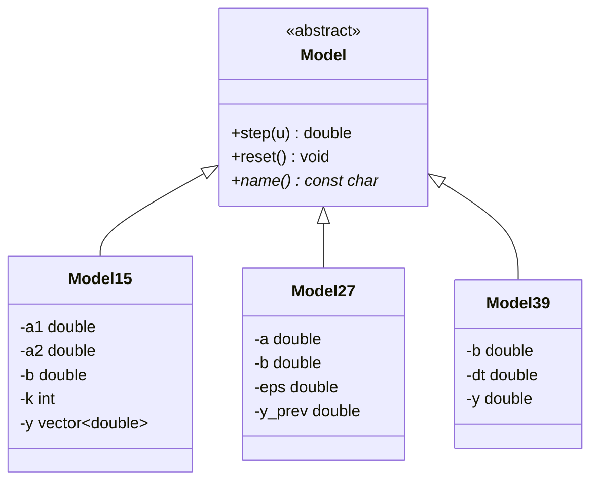
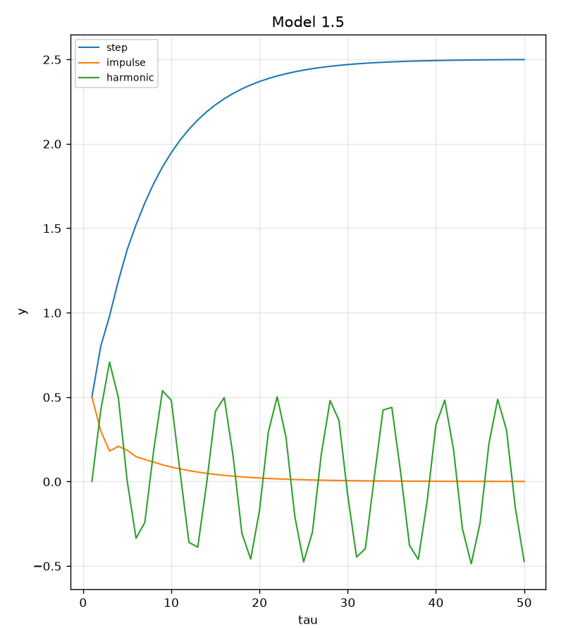
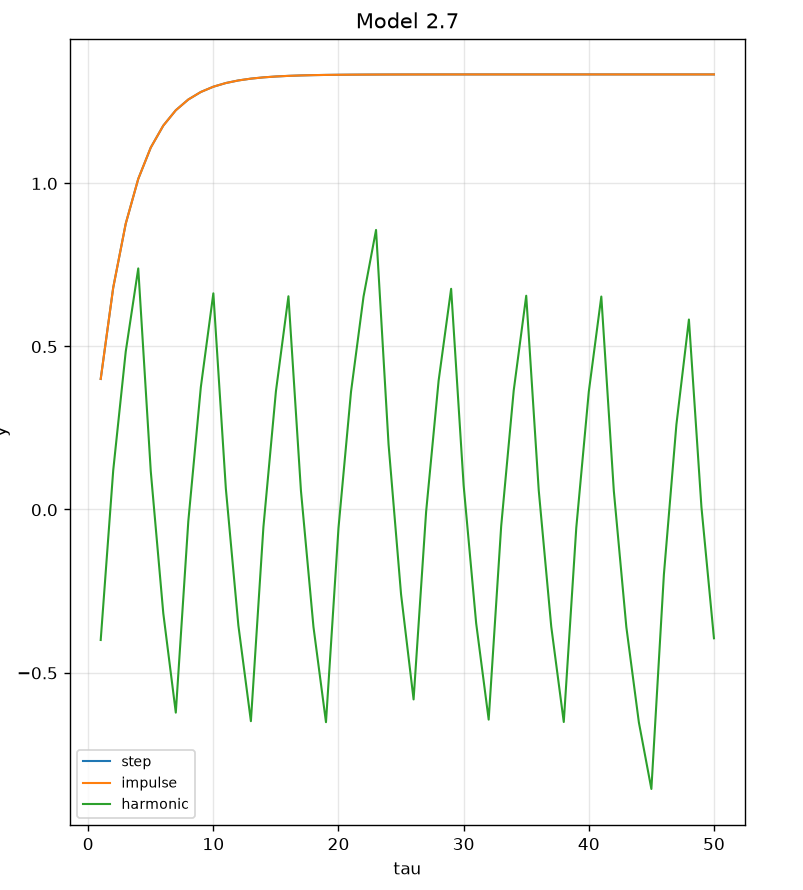
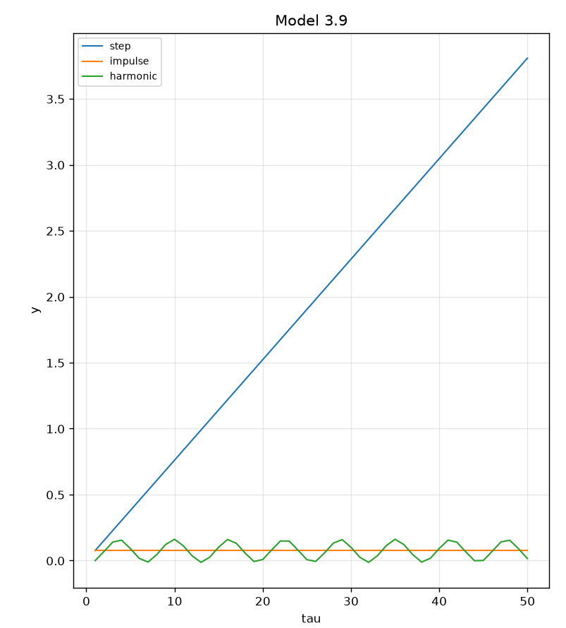
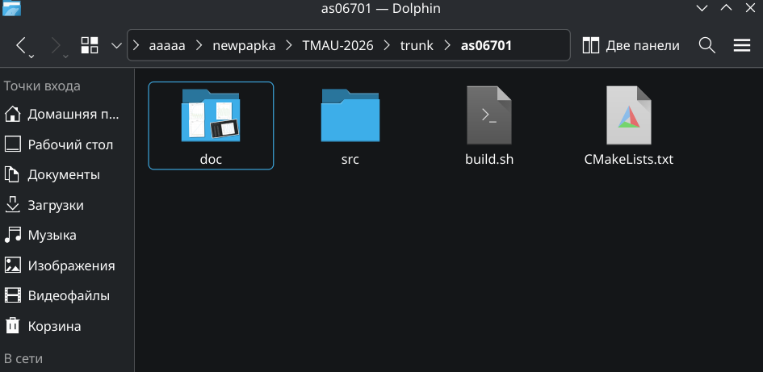
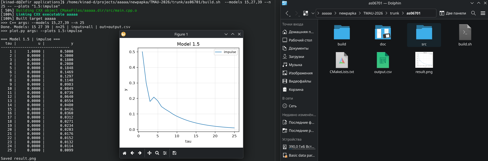
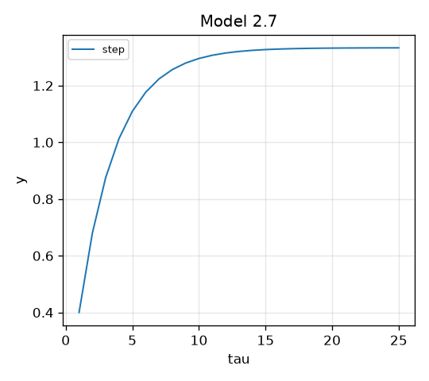

<p align="center">Министерство образования Республики Беларусь</p>
<p align="center">Учреждение образования</p>
<p align="center">“Брестский Государственный технический университет”</p>
<p align="center">Кафедра ИИТ</p>
<br><br><br><br><br><br><br>
<p align="center">Лабораторная работа №1</p>
<p align="center">По дисциплине “Теория и методы автоматического управления”</p>
<br><br><br><br><br>
<p align="right">Выполнил:</p>
<p align="right">Студент 3 курса</p>
<p align="right">Группы АС-67</p>
<p align="right">Анбросенко Д. А.</p>
<p align="right">Проверил:</p>
<p align="right">Дворанинович Д. А.</p>
<br><br><br><br><br>
<p align="center">Брест 2026</p>


## Вариант 5

- Линейная модель: **Model 1.5 (System with State Delay)**
- Нелинейная модель: **Model 2.7 (Relay with Hysteresis Element)**
- Дифференциальное уравнение: **Model 3.9 (Bounded Saturation Rate)**

## Реализованные модели

### Model 1.5 (System with State Delay)

```math
y_{\tau+1} = a_1\,y_\tau + a_2\,y_{\tau-k} + b\,u_\tau
```

где `a₁, a₂, b` — константы, `k ≥ 1` — шаг запаздывания по состоянию.
При `τ < k` значение `y_{τ-k}` принимается равным нулю (нулевые начальные условия).

### Model 2.7 (Relay with Hysteresis Element)

```math
y_{\tau+1} = a\,y_\tau + b\cdot\mathrm{relay}(u_\tau, y_\tau)
```

```math
\mathrm{relay}(u, y) =
\begin{cases}
+1, & u > \varepsilon \;\text{или}\; (u \ge -\varepsilon \;\text{и}\; y > 0) \\
-1, & u < -\varepsilon \;\text{или}\; (u \le \varepsilon \;\text{и}\; y \le 0)
\end{cases}
```

`ε` — полуширина зоны нечувствительности реле. Ветвь `y_τ` в условии реализует гистерезис: реле «залипает» в предыдущем положении, пока вход не выйдет из мёртвой зоны.

### Model 3.9 (Bounded Saturation Rate)

```math
\frac{dy}{dt} = b\,\tanh(u)
```

Дискретизация методом Эйлера с шагом `Δt`:

```math
y_{\tau+1} = y_\tau + \Delta t \cdot b \cdot \tanh(u_\tau)
```

---

## Входные воздействия

Амплитуда `A = 1` для всех типов (задаётся по умолчанию).

1. **Ступенчатое:** `u_τ = A`
2. **Импульсное:** `u_0 = A`, `u_{τ>0} = 0`
3. **Гармоническое:** `u_τ = A·sin(τ)`

---

## Архитектура (ООП)

Создан абстрактный базовый класс `Model` с чисто виртуальными методами:

- `step(u)` — выполнить один шаг симуляции, вернуть новое `y`;
- `reset()` — сбросить внутреннее состояние в начальное;
- `name()` — вернуть человекочитаемое имя модели (`"Model 1.5"` и т.п.).

Состояние (история `y` для 1.5, `y_prev` для 2.7, `y` для 3.9) хранится **внутри** объекта-модели, поэтому `step` принимает только вход `u`. Такой дизайн изолирует параметры и состояние каждой модели и позволяет главному циклу работать с моделями через указатель на базу, не зная деталей реализации.

От базового класса наследуются:

- `Model15` — хранит `std::vector<double>` истории для доступа к `y_{τ-k}`;
- `Model27` — хранит одно предыдущее значение `y_prev` для гистерезиса;
- `Model39` — хранит одно значение `y`.

### UML



---

## Функционал программы

Программа:

- позволяет выбрать одну или несколько моделей (`--models`);
- принимает коэффициенты каждой модели через CLI;
- позволяет выбрать тип входного воздействия (`--input`);
- позволяет задать количество шагов `n` (`--n`);
- сохраняет результаты в `output.csv` в формате `model,input,tau,u,y`;
- через `src/plot.py` печатает таблицы в консоль и строит графики (matplotlib), с возможностью вывести на экран конкретные пары «модель:вход» (`--plots`), наложить их на один график (`--overlay`) или сохранить PNG без окна (`--no-show`);
- собирается через CMake

### Параметры моделей по умолчанию

| Модель | Параметр | Значение |
|--------|----------|----------|
| Model 1.5 | `a1`, `a2`, `b`, `k` | 0.6, 0.2, 0.5, 2 |
| Model 2.7 | `a`, `b`, `ε` | 0.7, 0.4, 0.1 |
| Model 3.9 | `b`, `Δt` | 1.0, 0.1 |

### Основные аргументы (C++)

| Флаг | По умолчанию | Назначение |
|------|--------------|-----------|
| `--models 15,27,39` | все три | какие модели считать |
| `--n N` | 50 | число шагов симуляции |
| `--input step\|impulse\|harmonic\|all` | all | тип входного воздействия |
| `--out FILE` | `output.csv` | выходной CSV |
| `--m15-a1`, `--m15-a2`, `--m15-b`, `--m15-k` | — | коэффициенты Model 1.5 |
| `--m27-a`, `--m27-b`, `--m27-eps` | — | коэффициенты Model 2.7 |
| `--m39-b`, `--m39-dt` | — | коэффициенты Model 3.9 |
| `--help`, `-h` | — | справка |

### Аргументы Python-визуализации

Передаются после разделителя `--`.

| Флаг | По умолчанию | Назначение |
|------|--------------|-----------|
| `--plots "2.7:harmonic,1.5:step"` | всё из CSV | какие пары «модель:вход» рисовать |
| `--overlay` | выкл. | все выбранные пары на одном subplot'е |
| `--no-show` | выкл. | не открывать окно (только `result.png`) |
| `--no-tables` | выкл. | не печатать таблицы в консоль |
| `--csv FILE` | `output.csv` | откуда читать |
| `--png FILE` | `result.png` | куда сохранить картинку |

Всё **до `--`** передаётся C++-программе (что считать), всё **после `--`** — Python-скрипту (что рисовать). Разделитель можно не писать, если Python-аргументы не нужны.

---

## Пример работы программы

### Демонстрация исполняемого файла

.png)

### Демонстрация модели 1.5



### Демонстрация модели 2.7



### Демонстрация модели 3.9



### Демонстрация корректности создания файлов:

# До 



# Посел 



### Демонстрация созданного файла (В данном случае ступенчатое воздействие в модели 2.7)

